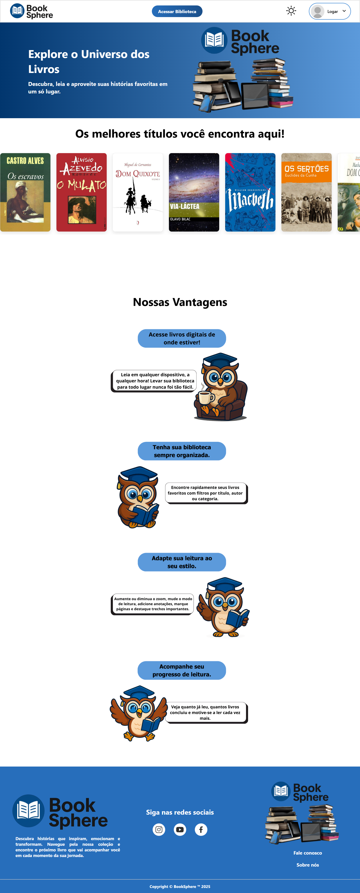

# 📚 BookSphere

O **BookSphere** é uma plataforma digital desenvolvida para incentivar a leitura e facilitar a descoberta de livros. O projeto oferece um ambiente onde os usuários podem explorar obras literárias, conhecer novas histórias e acessar conteúdos de leitura em um só lugar.

Desenvolvido em equipe como Trabalho de Conclusão de Curso (TCC), o projeto reúne recursos de navegação, catálogo de livros e interação com o usuário.

## ✨ Funcionalidades

- Página inicial com apresentação da plataforma.
- Catálogo digital com diversas obras literárias.
- Galeria de livros com capas e informações.
- Pesquisa e filtros para encontrar livros.
- Visualização de sinopses.
- Área de leitura de livros.
- Cadastro e login de usuários.
- Perfil de usuário.
- Alternância entre modo claro e escuro.
- Personalização da experiência de leitura.
- Páginas institucionais e formulário de contato.

## 💻 Tecnologias utilizadas

- HTML5
- CSS3
- JavaScript
- PHP
- MySQL

## 🖼️ Demonstração

Acesse a versão online:

[BookSphere — Acessar plataforma](https://victoroliveira2303.github.io/BookSphere/pasta-html/home.html)

## 👥 Desenvolvimento

Projeto acadêmico desenvolvido em equipe como Trabalho de Conclusão de Curso (TCC), com o objetivo de criar uma plataforma digital voltada à leitura e à descoberta de obras literárias.

## 📄 Licença

Projeto desenvolvido para fins acadêmicos.